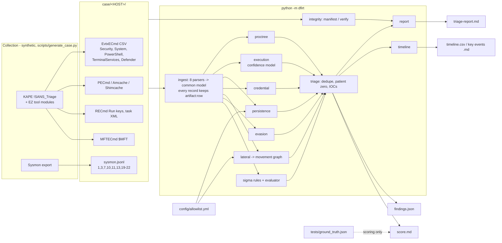
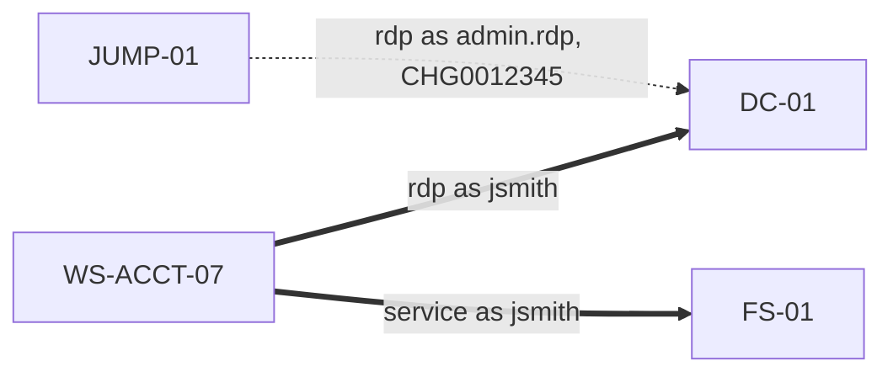

# Windows DFIR Triage (`dfirt`)

Windows endpoint forensic triage for Tier 2 SOC escalations: parse KAPE / Eric Zimmerman tool output and Sysmon, rebuild process trees, prove execution, hunt persistence and lateral movement, and produce a court-ready triage report with evidence integrity.

   

## Why this project exists

When Tier 1 escalates an endpoint, the alert has already done its job. Tier 2 has to answer harder questions from forensic artifacts, not alerts: did the binary actually *run*, or is it only present on disk? How did the attacker get in, and how do they get back in after a reboot? Which other hosts and accounts are now in scope? Can the evidence behind each claim stand up in review? Real analysts answer those questions from KAPE collections parsed by EvtxECmd, PECmd, AmcacheParser, AppCompatCacheParser, RECmd and MFTECmd. This repo ingests exports in those formats (plus Sysmon), runs the analysis a Tier 2 analyst does by hand, and writes a report where every finding cites the artifact file and row it came from. It is built against a synthetic three-host intrusion with planted benign look-alikes, and it scores itself against ground truth.

## What it demonstrates

- **Artifact parsing** for seven tool export formats plus scheduled-task XML, normalized into one event model that keeps `artifact:row` provenance on every record
- **Evidence integrity**: SHA-256 manifest, chain-of-custody entries, and a `verify` that catches a single changed byte, a missing file or an added one; `triage --manifest` refuses to report on unverified evidence
- **Process-tree reconstruction** from Sysmon EventID 1 by `ProcessGuid` (not PID), with lineage rules: Office spawning a script host, `svchost.exe` outside System32 or with the wrong parent, unexpected `services.exe` children, and non-system LSASS access
- **Proof of execution** with an explicit confidence model across Prefetch, Sysmon 1, 4688, Amcache and Shimcache. It gets the nuance right: Shimcache alone does **not** prove execution on Windows 10+, and two binaries with the same name never share evidence
- **Persistence hunting** (Run keys, services, scheduled tasks, WMI subscriptions, Startup folder), judged by target path and writer, with a ticketed allowlist
- **Credential access**: Kerberoasting (RC4 `0x17` TGS bursts across several service accounts by one requester, with tested thresholds) and LSASS `GrantedAccess` analysis
- **Lateral movement**: Type 3 / Type 10 logons, 4672, 1149, a service install after a network logon, 4648 explicit credentials, a host-to-host graph in Mermaid, and allowlisted admin RDP (account + jump host + target + business hours)
- **Defense evasion**: 1102 / 104 log clears, Defender 5001, `$SI` < `$FN` timestomping, masquerading
- **Detection engineering**: 11 Sigma rules plus a small Sigma evaluator; tests prove each rule fires on the attack and on none of the benign rows
- **Measured accuracy**: precision and recall against a generated `ground_truth.json`, a benign-only negative control, and byte-for-byte reproducible data and reports

## For hiring managers (30-second version)

| Tier 2 SOC requirement | Where it is proven |
| --- | --- |
| Investigate incidents escalated from Tier 1 | `python -m dfirt triage case/` turns 20 artifact files from 3 hosts into a 12-section report ([examples/triage-report.md](examples/triage-report.md)) |
| Determine root cause and patient zero | Process tree and patient-zero logic in `dfirt/proctree.py`, `dfirt/triage.py`; report section 4 |
| Determine scope (hosts, accounts) | Movement graph in `dfirt/lateral.py`; scoping rules in [docs/triage-workflow.md](docs/triage-workflow.md) |
| Host forensics on Windows artifacts | Parsers in `dfirt/ingest/`; [docs/artifact-cheatsheet.md](docs/artifact-cheatsheet.md) |
| Know what an artifact can and cannot prove | `dfirt/execution.py`, [docs/execution-evidence.md](docs/execution-evidence.md), `tests/test_execution.py` |
| Threat hunting for persistence and credential theft | `dfirt/persistence.py`, `dfirt/credential.py` |
| Reduce false positives | 13 benign look-alikes in the case; `config/allowlist.yml`; the benign-only negative-control test |
| Write and validate detections | `dfirt/sigma/rules/*.yml` + evaluator; `tests/test_sigma.py` |
| Evidence handling / chain of custody | `dfirt/integrity.py`, `examples/MANIFEST.json`, `tests/test_integrity.py` |
| Clear, defensible reporting | Every finding cites `host/artifact:row`; IOCs defanged; collection gaps stated |

## Framework mapping

| Capability | Security+ SY0-701 | MITRE ATT&CK | NIST CSF 2.0 | NIST SP 800-61 |
| --- | --- | --- | --- | --- |
| Manifest, verify, chain of custody | 4.8 Incident response (digital forensics: chain of custody, preservation, acquisition) | - | RS.AN-07 (collect and preserve incident data, integrity and provenance) | Detection & Analysis (evidence gathering and handling) |
| Process tree, initial access | 4.9 Data sources (endpoint logs, OS logs); 2.4 Indicators of malicious activity | T1566.001, T1059.001, T1204.002 | DE.AE-02 (analyze adverse events) | Detection & Analysis |
| Proof of execution | 4.8 Digital forensics; 4.9 Data sources | T1204.002, T1036.005 | RS.AN-03 (determine what took place) | Detection & Analysis |
| Persistence | 2.4 Indicators (persistence, unexpected autoruns); 4.5 Endpoint hardening | T1547.001, T1053.005, T1543.003, T1546.003 | DE.CM-09 (monitor endpoints), RS.AN-03 | Detection & Analysis; Eradication |
| Credential access | 2.4 Password attacks, privilege escalation indicators; 4.6 IAM | T1558.003, T1003.001 | DE.AE-02, RS.MI-02 (eradicate / rotate) | Containment, Eradication |
| Lateral movement graph and scope | 4.8 Incident response (analysis, scoping); 4.9 Data sources | T1021.001, T1021.002, T1550 | RS.AN-03, RS.MA-03 (categorize and prioritize) | Detection & Analysis (scoping) |
| Defense evasion | 2.4 Indicators (missing logs, out-of-cycle logging) | T1070.001, T1070.006, T1562.001, T1036.005 | DE.AE-02 | Detection & Analysis |
| Discovery, staging, C2 | 2.4 Indicators of malicious activity | T1087.002, T1069.002, T1018, T1033, T1135, T1560.001, T1074.001, T1071.001 | DE.AE-03 (correlate across sources) | Detection & Analysis |
| Sigma rules | 4.4 Security alerting and monitoring | tagged per rule | DE.CM, ID.IM-02 (improve from tests) | Preparation; Post-Incident Activity |
| Triage report, recommendations | 4.8 Incident response (containment, eradication, recovery, lessons learned); 5.1 Reporting | ATT&CK table in every report | RS.CO-03 (share information), RS.MI-01/02 | Containment, Eradication & Recovery |

## Architecture



The detectors never read `ground_truth.json`; it is written by the generator for the tests and the scorer only.

## Quickstart

```bash
git clone https://github.com/brooklynkid707-cmd/windows-dfir-triage.git
cd windows-dfir-triage
pip install -r requirements.txt     # pyyaml + pytest
make test                           # 91 passed
make demo                           # verify evidence, then every command below
```

Individual commands:

```bash
python -m dfirt manifest case --out output/MANIFEST.json        # hash every artifact at collection
python -m dfirt verify case --manifest examples/MANIFEST.json    # exit 1 on any tampering
python -m dfirt triage case --manifest examples/MANIFEST.json --out output/report.md --json output/findings.json
python -m dfirt proctree case/WS-ACCT-07
python -m dfirt execution case svchost.exe
python -m dfirt timeline case --csv output/timeline.csv
python -m dfirt timeline case --key-events --md output/key-events.md
python -m dfirt sigma case
make data                                                        # regenerate case/, ground truth, manifest
```

Every subcommand has `--help`.

## Sample output

Captured from `make demo` on the committed synthetic case. The full report is [examples/triage-report.md](examples/triage-report.md).

### Process tree for patient zero

```text
$ python -m dfirt proctree case/WS-ACCT-07
Process tree for WS-ACCT-07 (8 processes, Sysmon EventID 1):
[parent not in log: services.exe (712)]
└── svchost.exe (980) 12:40:00 SYSTEM  -k netsvcs -p
[parent not in log: ccmexec.exe (2200)]
└── powershell.exe (3344) 12:50:00 svc_sccm  -ExecutionPolicy Bypass -File C:\Windows\CCM\ScriptStore\inventory...
[parent not in log: explorer.exe (3900)]
└── outlook.exe (4120) 13:05:10 jsmith  /recycle
    └── winword.exe (4680) 13:05:30 jsmith  /n "C:\Users\jsmith\Downloads\Invoice_Oct.docm"
        └── powershell.exe (5012) 13:06:00 jsmith  -nop -w hidden -enc SQBFAFgAIAAoAEkATgBFAFIAVAAtAFMAQQBNAFAATABFACkA   <-- Office spawned script host
            └── svchost.exe (6102) 13:06:31 jsmith   <-- svchost.exe outside System32; opened LSASS 0x1410
                ├── schtasks.exe (6240) 13:06:45 jsmith  /create /tn "MicrosoftEdgeUpdateTaskUser" /tr "C:\Users\jsmith\AppData...
                └── net.exe (6400) 13:08:30 jsmith  user /domain

Anomalous lineage:
  [high] T1059.001 winword.exe spawned powershell.exe (Office application spawning a script host)
  [high] T1036.005 svchost.exe running from non-System32 path C:\Users\jsmith\AppData\Roaming\Microsoft\svchost.exe
  [critical] T1003.001 LSASS accessed by non-system process svchost.exe
```

The two trees above the attack are the benign look-alikes. The real `svchost.exe` (System32, parent `services.exe`) and the SCCM PowerShell (parent `CcmExec.exe`, `-File`, not encoded) produce no findings.

### Execution-evidence matrix

| Host | Binary | Prefetch | Sysmon 1 | 4688 | Amcache | Shimcache | Run count | Verdict |
| --- | --- | --- | --- | --- | --- | --- | --- | --- |
| WS-ACCT-07 | `C:\Users\jsmith\AppData\Roaming\Microsoft\svchost.exe` | yes | yes | yes | yes | yes | 3 | **confirmed** |
| FS-01 | `C:\Windows\PSEXESVC.exe` | yes | yes | - | yes | yes | 1 | **confirmed** |
| FS-01 | `C:\Users\Public\7za.exe` | yes | yes | - | yes | yes | 1 | **confirmed** |
| WS-ACCT-07 | `C:\Users\jsmith\Downloads\ProcessExplorer\procexp64.exe` | - | - | - | - | yes | - | **possible** |

The last row is the important one. That tool shows up only in Shimcache, so the honest verdict is "present, no evidence it ran", not "executed". The payload's Shimcache timestamp is 2019-03-19: that is its backdated `$SI` modified time, which is a second reason never to read Shimcache times as run times.

```text
$ python -m dfirt execution case procexp64.exe
[WS-ACCT-07] C:\Users\jsmith\Downloads\ProcessExplorer\procexp64.exe
  verdict : POSSIBLE (proves execution: False)
  sources : shimcache
    - shimcache appcompatcache_AppCompatCacheParser.csv:2
  why     : Only Shimcache references this path. Shimcache records that the file existed and was enumerated by the shim engine; on Windows 8.1/10/11 the 'Executed' flag is not populated, so this is NOT evidence of execution.
```

### Host-to-host movement



The dotted edge is the sanctioned admin RDP from the jump host during business hours, with a change ticket. It is drawn so a reviewer can see it was considered, but it produces no finding.

### Scoring against ground truth

`tests/ground_truth.json` lists 22 planted facts (technique + host) and 13 benign look-alike rows. A finding is a true positive when its technique and host match a planted fact. A benign row cited as evidence by any finding counts as a false positive.

| Metric | Value |
| --- | --- |
| Planted facts recovered (recall) | 22/22 = 1.00 |
| Findings that match a planted fact (precision) | 22/22 = 1.00 |
| F1 | 1.00 |
| Benign look-alikes cited by any finding | 0/13 |
| Movement graph edges equal ground truth | yes |

| Tactic | Recovered / planted |
| --- | --- |
| Initial Access | 1/1 |
| Execution | 1/1 |
| Persistence | 4/4 |
| Defense Evasion | 4/4 |
| Credential Access | 2/2 |
| Discovery | 5/5 |
| Lateral Movement | 2/2 |
| Collection | 2/2 |
| Command and Control | 1/1 |

A perfect score on data I generated myself is the expected result, not an achievement; see the limitations below. The score is useful as a regression test: if a change to a detector breaks a planted fact or starts citing a benign row, the score drops and `tests/test_report_scoring.py` fails.

### Tests

```text
$ python -m pytest -q
...........................................................................................  [100%]
91 passed
```

## Project layout

```text
windows-dfir-triage/
├── dfirt/                         # python -m dfirt <command>
│   ├── cli.py                     # argparse front end: manifest, verify, triage, proctree, timeline, execution, sigma
│   ├── model.py                   # common event model, time parsing, path / masquerade helpers
│   ├── findings.py                # Finding + Evidence (host/artifact:row citations)
│   ├── ingest/                    # evtx, sysmon, prefetch, amcache, shimcache, recmd, mft, tasks
│   ├── integrity.py               # SHA-256 manifest, chain of custody, verify
│   ├── proctree.py                # ProcessGuid trees + lineage rules
│   ├── execution.py               # evidence-of-execution confidence model
│   ├── persistence.py  credential.py  lateral.py  evasion.py
│   ├── allowlist.py               # exact-match suppression from config/allowlist.yml
│   ├── triage.py                  # run all detectors, dedupe, patient zero, IOCs
│   ├── timeline.py                # super-timeline + key-events view (CSV / Markdown)
│   ├── report.py                  # 12-section Markdown triage report
│   ├── scoring.py                 # precision / recall vs ground truth
│   └── sigma/                     # 11 rules (rules/*.yml) + minimal evaluator
├── case/                          # synthetic KAPE/EZ exports for WS-ACCT-07, FS-01, DC-01 (generated, committed)
├── config/allowlist.yml           # sanctioned RDP, Run keys, tasks, services (each with a ticket)
├── scripts/generate_case.py       # deterministic generator (+ _spine.py: the planted story)
├── examples/                      # committed make-demo output: report, findings, score, timelines, manifest
├── docs/
│   ├── artifact-cheatsheet.md     # what each artifact proves, where it lives, parser, pitfalls, columns used
│   ├── execution-evidence.md      # the confidence model and common reporting mistakes
│   └── triage-workflow.md         # order of volatility, KAPE targets, analysis order, scoping
├── tests/                         # 91 pytest tests + ground_truth.json
├── .github/workflows/tests.yml    # Python 3.11 / 3.12
├── Makefile  requirements.txt  LICENSE  .gitignore
└── output/                        # ad-hoc output (git-ignored)
```

## Limitations and honest notes

- **All data is synthetic.** Northwind Logistics, its users, hosts, hashes and indicators are invented. The external addresses are RFC 5737 documentation ranges and the domains are `.example`. The payload "hashes" are SHA-256/SHA-1 of a fixed label string, not of any real file. The encoded PowerShell argument and the 4104 script block are inert placeholders that cannot be run.
- **The exports approximate the real tools.** Column names follow EvtxECmd, PECmd, AmcacheParser, AppCompatCacheParser, RECmd and MFTECmd as closely as I know them, but real EvtxECmd fills `PayloadData1..6` from per-event maps with free text. Here each EventID uses a fixed slot, as documented in [docs/artifact-cheatsheet.md](docs/artifact-cheatsheet.md). Expect to adjust the parsers when you point them at real tool output. The repo does not parse raw `.evtx`, `.pf`, hives or `$MFT`; it consumes tool exports, the same as an analyst does.
- **The scoring is self-graded.** The same person wrote the story, the detectors and the ground truth, so 1.00 precision and recall shows that the detectors and the planted facts agree. It does not show real-world accuracy. Real environments have far more benign variety than 13 look-alikes; the benign-only negative-control test and the allowlist design are the parts meant to carry over.
- **The thresholds are illustrative.** Kerberoasting fires at 3 or more distinct RC4 service accounts from one requester within 10 minutes, and timestomping fires when `$SI` created is at least 1 day earlier than `$FN` created. A real deployment would baseline both. Some legacy applications still negotiate RC4, and some installers legitimately set file times.
- **Some analysis is simplified.** Patient zero is "the movement source that is never a destination and holds the initial-access lineage", which is enough for one clean chain but not for multiple intrusions. Lateral-movement edges map IPs to hosts with a static table instead of DHCP/DNS history. The Sigma evaluator implements the subset of the grammar these rules use (selections, `and`/`not`, `1 of`, `contains`/`startswith`/`endswith`/`re`/`all`, logsource gating). It is not a full Sigma backend.
- **A real case would add** memory analysis (Volatility), USN journal and `$LogFile`, SRUM and network usage, LNK/JumpLists/ShellBags for user activity, browser history for the delivery vector, proxy/DNS/firewall logs to confirm or rule out exfiltration, and EDR telemetry. The report's collection-gaps section says which of these would change the conclusions here.
- **Nothing here is offensive tooling.** The logs *describe* attacker activity as evidence, and the repo contains no exploit, payload or credential-access code.

## License

MIT - see [LICENSE](LICENSE). Copyright 2026 JP Scirica.
