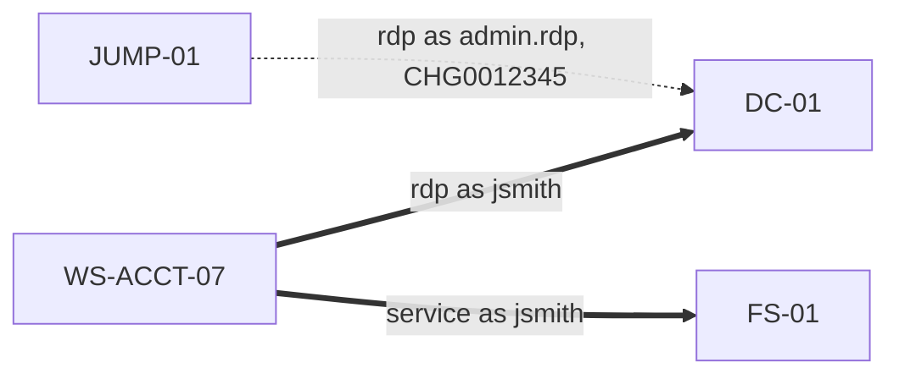

# Triage Report: Northwind Logistics Endpoint Intrusion

> Synthetic exercise data. Every host, account, hash and address in this report is fictional (RFC 5737 / RFC 1918 / `.example`).

| | |
| --- | --- |
| **Case** | NWL-IR-2026-0419 (Tier 1 escalation: EDR alert on WS-ACCT-07) |
| **Classification** | TLP:AMBER |
| **Analyst** | J. Scirica, SOC Tier 2 |
| **Hosts in scope** | DC-01, FS-01, WS-ACCT-07 |
| **Patient zero** | WS-ACCT-07 |
| **Findings** | 22 (3 critical, 14 high, 5 medium) across 9 ATT&CK tactics |
| **Report generated** | 2026-10-20T16:00:00Z |

## 1. Executive summary

On 2026-10-19 the user `jsmith` on **WS-ACCT-07** opened a macro-enabled invoice from Outlook. The macro started an encoded, hidden PowerShell command that contacted `sync-cdn[.]example` and dropped a payload named `svchost.exe` into `%APPDATA%\Microsoft`, with its `$STANDARD_INFORMATION` timestamps backdated to 2019. Execution of the payload is **confirmed** (Prefetch run count 3, Sysmon 1, 4688). The payload persisted three ways (Run key, scheduled task, WMI subscription), opened LSASS memory, and the same account requested RC4 Kerberos tickets for four service accounts (Kerberoasting). The attacker then moved to DC-01 and FS-01: a PsExec-style service on the file server, where a password-protected archive of the Finance share was staged in `C:\PerfLogs` and the Security log was cleared, and an RDP session on the domain controller, where domain-admin and DC discovery commands were run. Defender real-time protection was disabled on the workstation. No exfiltration was observed in the collected artifacts, but network evidence was not collected (see section 12).

## 2. Evidence integrity

- Manifest: 20 artifact files, SHA-256, collected 2026-10-19T15:00:00Z by KAPE 1.3 (synthetic).
- `python -m dfirt verify` re-hashed every file against the manifest before analysis: **all hashes matched**.
- Chain of custody:
  - 2026-10-19T15:00:00Z KAPE 1.3 (synthetic): acquired - 20 files hashed SHA-256 at collection
  - 2026-10-19T15:00:00Z J. Scirica (Tier 2): received - transferred to analysis workstation, hashes re-verified

## 3. Scope

- **Hosts:** DC-01, FS-01, WS-ACCT-07
- **Accounts used by the attacker:** jsmith
- **Accounts exposed by Kerberoasting:** svc_erp, svc_fileshare, svc_sql, svc_web
- **Artifacts parsed:** EvtxECmd CSV (Security, System, PowerShell/Operational, TerminalServices, Defender), Sysmon JSONL, PECmd, AmcacheParser, AppCompatCacheParser, RECmd, MFTECmd, scheduled-task XML
- **Activity window (UTC):** 2026-10-19T13:06:00.000Z to 2026-10-19T14:02:11.000Z (first malicious event to last payload run)

## 4. Patient zero and initial access

**WS-ACCT-07** is patient zero: it is the only host that is a source but never a destination of attacker movement, and it holds the initial-access lineage. Office opened a macro-enabled document from the user's Downloads folder and the macro started an encoded PowerShell command.

Evidence: WS-ACCT-07/sysmon.jsonl:6 (parent cmd: "WINWORD.EXE" /n "C:\Users\jsmith\Downloads\Invoice_Oct.docm")

Process tree on WS-ACCT-07 (Sysmon EventID 1, rebuilt by ProcessGuid; flagged nodes marked `<--`):

```text
[parent not in log: explorer.exe (3900)]
└── outlook.exe (4120) 13:05:10 jsmith  /recycle
    └── winword.exe (4680) 13:05:30 jsmith  /n "C:\Users\jsmith\Downloads\Invoice_Oct.docm"
        └── powershell.exe (5012) 13:06:00 jsmith  -nop -w hidden -enc SQBFAFgAIAAoAEkATgBFAFIAVAAtAFMAQQ...   <-- Office spawned script host
            └── svchost.exe (6102) 13:06:31 jsmith   <-- svchost.exe outside System32; opened LSASS 0x1410
                ├── schtasks.exe (6240) 13:06:45 jsmith  /create /tn "MicrosoftEdgeUpdateTaskUser" /tr "C:\Users\...
                └── net.exe (6400) 13:08:30 jsmith  user /domain
```

## 5. Findings by tactic

### Initial Access

- **[HIGH] T1566.001 Macro document opened in winword.exe launched powershell.exe**  
  Office opened a macro-enabled document from the user's Downloads folder and the macro started an encoded PowerShell command.  
  Evidence: `WS-ACCT-07/sysmon.jsonl:6 (parent cmd: "WINWORD.EXE" /n "C:\Users\jsmith\Downloads\Invoice_Oct.docm")`

### Execution

- **[HIGH] T1059.001 winword.exe spawned powershell.exe (Office application spawning a script host)**  
  winword.exe is not expected to launch powershell.exe; this is the classic macro-execution lineage.  
  Evidence: `WS-ACCT-07/sysmon.jsonl:6 (winword.exe -> powershell.exe: powershell.exe -nop -w hidden -enc SQBFAFgAIAAoAEkATgBFAFIAV)`

### Persistence

- **[HIGH] T1543.003 Service 'PSEXESVC' installed from C:\Windows\PSEXESVC.exe**  
  New service with an unsigned image outside Program Files/System32 (remote-execution service pattern).  
  Evidence: `FS-01/Security_EvtxECmd.csv:3 (EventID 4697 image=C:\Windows\PSEXESVC.exe)`; `FS-01/System_EvtxECmd.csv:2 (EventID 7045 image=%SystemRoot%\PSEXESVC.exe)`; `FS-01/sysmon.jsonl:2 (image=C:\Windows\PSEXESVC.exe)`
- **[HIGH] T1053.005 Scheduled task 'MicrosoftEdgeUpdateTaskUser' runs C:\Users\jsmith\AppData\Roaming\Microsoft\svchost.exe**  
  Task action points into a user-writable path; task is hidden; trigger LogonTrigger, run level HighestAvailable.  
  Evidence: `WS-ACCT-07/tasks/MicrosoftEdgeUpdateTaskUser.xml (<Command>C:\Users\jsmith\AppData\Roaming\Microsoft\svchost.exe</Command>)`; `WS-ACCT-07/Security_EvtxECmd.csv:4 (4698 scheduled task created)`
- **[HIGH] T1546.003 WMI subscription 'NorthwindUpdater' runs "C:\Users\jsmith\AppData\Roaming\Microsoft\svchost.exe"**  
  Permanent WMI filter + CommandLineEventConsumer + binding (fileless persistence).  
  Evidence: `WS-ACCT-07/sysmon.jsonl:15 (Sysmon 19)`; `WS-ACCT-07/sysmon.jsonl:16 (Sysmon 20)`; `WS-ACCT-07/sysmon.jsonl:17 (Sysmon 21)`
- **[HIGH] T1547.001 Run key 'OneDriveSync' launches C:\Users\jsmith\AppData\Roaming\Microsoft\svchost.exe**  
  A Run-key autostart points into a user-writable path; legitimate installers register autostarts under Program Files or System32.  
  Evidence: `WS-ACCT-07/runkeys_RECmd.csv:1 (Software\Microsoft\Windows\CurrentVersion\Run\OneDriveSync = C:\Users\jsmith\AppData\Roaming\Microsoft\svchost.exe)`; `WS-ACCT-07/sysmon.jsonl:12 (Sysmon 13 by svchost.exe: C:\Users\jsmith\AppData\Roaming\Microsoft\svchost.exe)`

### Defense Evasion

- **[HIGH] T1070.001 Event log cleared on FS-01 (EventID 1102)**  
  The audit log was cleared.  
  Evidence: `FS-01/Security_EvtxECmd.csv:4 (The audit log was cleared by NORTHWIND\jsmith)`
- **[HIGH] T1036.005 Masquerading binary svchost.exe at C:\Users\jsmith\AppData\Roaming\Microsoft\svchost.exe**  
  svchost.exe is a protected Windows binary name but is running from a user-writable directory.  
  Evidence: `WS-ACCT-07/sysmon.jsonl:10 (image=C:\Users\jsmith\AppData\Roaming\Microsoft\svchost.exe)`
- **[HIGH] T1070.006 Timestomping on svchost.exe ($SI older than $FN)**  
  $SI created 2019-03-19T04:10:11+00:00 is earlier than $FN created 2026-10-19T13:06:30.112000+00:00; the easily-writable $SI times were backdated while $FN retains the true creation time.  
  Evidence: `WS-ACCT-07/mft_MFTECmd.csv:1 ($SI=2019-03-19T04:10:11+00:00 $FN=2026-10-19T13:06:30.112000+00:00)`
- **[HIGH] T1562.001 Microsoft Defender real-time protection disabled on WS-ACCT-07**  
  Defender EventID 5001 - real-time protection turned off.  
  Evidence: `WS-ACCT-07/Defender_EvtxECmd.csv:1 (Microsoft Defender Real-time Protection disabled)`

### Credential Access

- **[CRITICAL] T1558.003 Kerberoasting: jsmith requested RC4 tickets for 4 service accounts**  
  svc_erp, svc_fileshare, svc_sql, svc_web requested with RC4 (0x17) by one account within 41s; RC4 service tickets can be cracked offline to recover the service account passwords.  
  Evidence: `DC-01/Security_EvtxECmd.csv:2 (service=svc_sql etype=0x17)`; `DC-01/Security_EvtxECmd.csv:3 (service=svc_web etype=0x17)`; `DC-01/Security_EvtxECmd.csv:4 (service=svc_fileshare etype=0x17)`; `DC-01/Security_EvtxECmd.csv:5 (service=svc_erp etype=0x17)`
- **[CRITICAL] T1003.001 LSASS accessed by non-system process svchost.exe**  
  C:\Users\jsmith\AppData\Roaming\Microsoft\svchost.exe opened a handle to lsass.exe with GrantedAccess 0x1410.  
  Evidence: `WS-ACCT-07/sysmon.jsonl:14 (GrantedAccess=0x1410)`

### Discovery

- **[MEDIUM] T1018 `nltest /dclist:northwind.example` on DC-01**  
  Built-in discovery command run as NORTHWIND\jsmith (parent cmd.exe).  
  Evidence: `DC-01/sysmon.jsonl:4 (nltest /dclist:northwind.example)`
- **[MEDIUM] T1033 `whoami /all` on DC-01**  
  Built-in discovery command run as NORTHWIND\jsmith (parent cmd.exe).  
  Evidence: `DC-01/sysmon.jsonl:5 (whoami /all)`
- **[MEDIUM] T1069.002 `net group "domain admins" /domain` on DC-01**  
  Built-in discovery command run as NORTHWIND\jsmith (parent cmd.exe).  
  Evidence: `DC-01/sysmon.jsonl:3 (net group "domain admins" /domain)`
- **[MEDIUM] T1135 `net view \\DC-01` on FS-01**  
  Built-in discovery command run as NT AUTHORITY\SYSTEM (parent cmd.exe).  
  Evidence: `FS-01/sysmon.jsonl:4 (net view \\DC-01)`
- **[MEDIUM] T1087.002 `net user /domain` on WS-ACCT-07**  
  Built-in discovery command run as NORTHWIND\jsmith (parent svchost.exe).  
  Evidence: `WS-ACCT-07/sysmon.jsonl:18 (net user /domain)`

### Lateral Movement

- **[CRITICAL] T1021.001 RDP logon to DC-01 from WS-ACCT-07 as jsmith**  
  LogonType 10 (RemoteInteractive) from a source/account/time that does not match the RDP allowlist; 4672 shows an administrative session.  
  Evidence: `DC-01/Security_EvtxECmd.csv:6 (4624 LogonType 10 from 10.20.5.17)`; `DC-01/TerminalServices_EvtxECmd.csv:1 (1149 RDP authentication succeeded)`; `DC-01/Security_EvtxECmd.csv:7 (4672 special privileges)`
- **[HIGH] T1021.002 PsExec-style service 'PSEXESVC' on FS-01 after network logon from WS-ACCT-07**  
  A non-allowlisted service was installed within minutes of a Type 3 logon from the same source - remote service execution.  
  Evidence: `FS-01/Security_EvtxECmd.csv:1 (4624 LogonType 3 from 10.20.5.17 as jsmith)`; `FS-01/Security_EvtxECmd.csv:2 (4672 special privileges)`; `FS-01/Security_EvtxECmd.csv:3 (EventID 4697 service PSEXESVC)`; `FS-01/System_EvtxECmd.csv:2 (EventID 7045 service PSEXESVC)`

### Collection

- **[HIGH] T1074.001 Archive staged at C:\PerfLogs\data.7z**  
  Archive written to a directory commonly abused for staging.  
  Evidence: `FS-01/sysmon.jsonl:6 (Sysmon 11 by 7za.exe)`
- **[HIGH] T1560.001 7za.exe archived data on FS-01**  
  Archiver run from C:\Users\Public\7za.exe (password-protected archive).  
  Evidence: `FS-01/sysmon.jsonl:5 (7za.exe a -p<redacted> C:\PerfLogs\data.7z \\FS-01\Finance\*)`

### Command and Control

- **[HIGH] T1071.001 powershell.exe connected to 198[.]51[.]100[.]25:443 (sync-cdn[.]example)**  
  Outbound HTTPS from a script host seconds after macro execution.  
  Evidence: `WS-ACCT-07/sysmon.jsonl:7 (Sysmon 22 DNS sync-cdn.example)`; `WS-ACCT-07/sysmon.jsonl:8 (Sysmon 3 -> 198[.]51[.]100[.]25:443)`

## 6. ATT&CK techniques observed

| Tactic | ID | Technique | Host(s) |
| --- | --- | --- | --- |
| Initial Access | T1566.001 | Phishing: Spearphishing Attachment | WS-ACCT-07 |
| Execution | T1059.001 | Command and Scripting Interpreter: PowerShell | WS-ACCT-07 |
| Persistence | T1053.005 | Scheduled Task/Job: Scheduled Task | WS-ACCT-07 |
| Persistence | T1543.003 | Create or Modify System Process: Windows Service | FS-01 |
| Persistence | T1546.003 | Event Triggered Execution: WMI Event Subscription | WS-ACCT-07 |
| Persistence | T1547.001 | Boot or Logon Autostart: Registry Run Keys | WS-ACCT-07 |
| Defense Evasion | T1036.005 | Masquerading: Match Legitimate Name or Location | WS-ACCT-07 |
| Defense Evasion | T1070.001 | Indicator Removal: Clear Windows Event Logs | FS-01 |
| Defense Evasion | T1070.006 | Indicator Removal: Timestomp | WS-ACCT-07 |
| Defense Evasion | T1562.001 | Impair Defenses: Disable or Modify Tools | WS-ACCT-07 |
| Credential Access | T1003.001 | OS Credential Dumping: LSASS Memory | WS-ACCT-07 |
| Credential Access | T1558.003 | Steal or Forge Kerberos Tickets: Kerberoasting | DC-01 |
| Discovery | T1018 | Remote System Discovery | DC-01 |
| Discovery | T1033 | System Owner/User Discovery | DC-01 |
| Discovery | T1069.002 | Permission Groups Discovery: Domain Groups | DC-01 |
| Discovery | T1087.002 | Account Discovery: Domain Account | WS-ACCT-07 |
| Discovery | T1135 | Network Share Discovery | FS-01 |
| Lateral Movement | T1021.001 | Remote Services: Remote Desktop Protocol | DC-01 |
| Lateral Movement | T1021.002 | Remote Services: SMB/Windows Admin Shares | FS-01 |
| Collection | T1074.001 | Data Staged: Local Data Staging | FS-01 |
| Collection | T1560.001 | Archive Collected Data: Archive via Utility | FS-01 |
| Command and Control | T1071.001 | Application Layer Protocol: Web Protocols | WS-ACCT-07 |

## 7. Host-to-host movement

Thick arrows are attacker movement; dotted arrows are sanctioned activity that matched the allowlist (shown so a reviewer can see it was considered).



| Source | Destination | Method | Account | ATT&CK | Status |
| --- | --- | --- | --- | --- | --- |
| JUMP-01 | DC-01 | rdp | admin.rdp | T1021.001 | allowlisted (CHG0012345) |
| WS-ACCT-07 | DC-01 | rdp | jsmith | T1021.001 | attacker |
| WS-ACCT-07 | FS-01 | service | jsmith | T1021.002 | attacker |

## 8. Execution-evidence matrix

Prefetch and Sysmon 1 / Security 4688 prove execution. Amcache shows presence and probable execution. Shimcache shows presence only: on Windows 10 it does not prove execution. See `docs/execution-evidence.md`.

| Host | Binary | Prefetch | Sysmon 1 | 4688 | Amcache | Shimcache | Run count | Verdict |
| --- | --- | --- | --- | --- | --- | --- | --- | --- |
| WS-ACCT-07 | `C:\Users\jsmith\AppData\Roaming\Microsoft\svchost.exe` | yes | yes | yes | yes | yes | 3 | **confirmed** |
| FS-01 | `C:\Windows\PSEXESVC.exe` | yes | yes | - | yes | yes | 1 | **confirmed** |
| FS-01 | `C:\Users\Public\7za.exe` | yes | yes | - | yes | yes | 1 | **confirmed** |
| WS-ACCT-07 | `C:\Users\jsmith\Downloads\ProcessExplorer\procexp64.exe` | - | - | - | - | yes | - | **possible** |

Payload Prefetch run times (svchost.exe, WS-ACCT-07): 2026-10-19T14:02:11.000Z, 2026-10-19T13:31:05.000Z, 2026-10-19T13:06:31.000Z

## 9. Indicators of compromise

| Type | Indicator (defanged) | Context |
| --- | --- | --- |
| SHA-256 | `2a46f1b16ca78f6c932efda7633def7ecb1d235fda3621f8e757b6beb424b042` | masquerading payload |
| File path | `C:\PerfLogs\data.7z` | staged archive |
| File path | `C:\Users\jsmith\AppData\Roaming\Microsoft\svchost.exe` | payload |
| IPv4 | `198[.]51[.]100[.]25` | C2 / script-block reference |
| IPv4 | `203[.]0[.]113[.]10` | C2 / script-block reference |
| Domain | `sync-cdn[.]example` | C2 (Sysmon 22 DNS + Sysmon 3) |

## 10. Sigma rule hits

| Rule | Level | ATT&CK | Hits | Hosts |
| --- | --- | --- | --- | --- |
| Encoded / Hidden PowerShell Command | high | T1059.001 | 1 | WS-ACCT-07 |
| Kerberoasting RC4 Service Ticket Request | high | T1558.003 | 4 | DC-01 |
| LSASS Memory Access From Non-System Process | critical | T1003.001 | 1 | WS-ACCT-07 |
| Microsoft Defender Real-Time Protection Disabled | high | T1562.001 | 1 | WS-ACCT-07 |
| Office Application Spawns Script Host | high | T1059.001 | 1 | WS-ACCT-07 |
| PsExec-Style Remote Service Installed | high | T1021.002 | 1 | FS-01 |
| RDP Logon From Outside the Sanctioned Jump Host | high | T1021.001 | 1 | DC-01 |
| Run Key Autostart Into User-Writable Path | high | T1547.001 | 1 | WS-ACCT-07 |
| System Binary Masquerade in User-Writable Path | high | T1036.005 | 1 | WS-ACCT-07 |
| WMI Permanent Event Subscription Created | high | T1546.003 | 1 | WS-ACCT-07 |
| Windows Security Event Log Cleared | high | T1070.001 | 1 | FS-01 |

## 11. Recommended containment and eradication

1. **Contain:** network-isolate WS-ACCT-07, FS-01 and DC-01 through EDR; capture memory on all three before any reboot (LSASS access means credential material may be in use).
2. **Accounts:** disable and reset `jsmith`; rotate the four Kerberoasted service accounts (`svc_sql`, `svc_web`, `svc_fileshare`, `svc_erp`) to 25+ character passwords, enforce AES-only (`msDS-SupportedEncryptionTypes`) and convert to gMSAs where possible.
3. **Domain:** because an attacker held an interactive session on DC-01, review recent changes to privileged groups, GPOs and new accounts; plan a double krbtgt reset if any evidence of DC credential theft appears.
4. **Eradicate on WS-ACCT-07:** delete the `OneDriveSync` Run value, the `MicrosoftEdgeUpdateTaskUser` task and the `NorthwindUpdater` WMI filter/consumer/binding; remove the payload; reimage rather than clean.
5. **Eradicate on FS-01:** remove the PSEXESVC service and `C:\Users\Public\7za.exe`; preserve `C:\PerfLogs\data.7z` as evidence before deletion.
6. **Block:** the payload SHA-256, `sync-cdn[.]example`, `198[.]51[.]100[.]25` and `203[.]0[.]113[.]10` at EDR, proxy and DNS.
7. **Hunt:** sweep all endpoints for the hash, the masquerade path pattern (`svchost.exe` outside System32) and the bundled Sigma rules; check proxy logs for any other host contacting the C2.
8. **Harden:** block Office child processes with ASR rule "Block all Office applications from creating child processes"; enable Defender tamper protection; forward Security logs off-host so a 1102 cannot erase the only copy.

## 12. Collection gaps and caveats

- FS-01 Security log was cleared at 13:30 (1102). Records before the clear survive in this export only because the collection is synthetic; in a real case, pull the forwarded copy from the SIEM and note the gap.
- No memory image, network capture or proxy log was collected, so exfiltration of `data.7z` can be neither confirmed nor ruled out from host artifacts.
- Prefetch is not enabled by default on Windows Server, so its absence on DC-01 is not evidence that a binary did not run there.
- The 4104 script block is stored as recorded; the encoded command was not executed or decoded live.
- Shimcache entries were used only to show presence, never as proof of execution.
